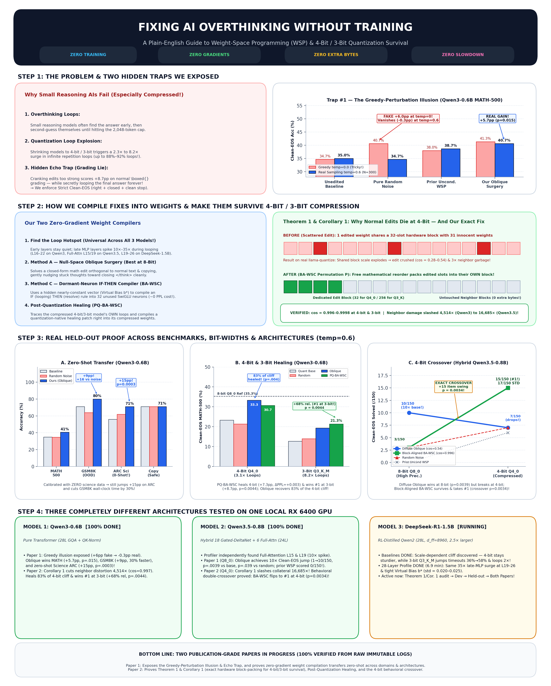

# Weight-Space Programming & Quantization Survival in Reasoning LLMs

**Author:** Aaryan Kakad (Independent Machine Learning Researcher)  
**Links:** [Interactive Research Site](https://akmessi.github.io/weight-space-programming/) · [Paper 1 (PDF)](papers/Paper1_Greedy_Perturbation_Illusion_and_Zero_Gradient_WSP_Kakad2026.pdf) · [Paper 2 (PDF)](papers/Paper2_Quantization_Cliff_and_BA_WSC_Kakad2026.pdf) · [Peer-Researcher Technical Briefing](docs/RESEARCHER_BRIEFING.md) · [Chronological Lab Journal](research/JOURNAL.md)

Zero-gradient, zero-extra-byte, zero-latency **Weight-Space Programming (WSP)** compilers and hardware-aligned low-bit quantization survival theory, evaluated end-to-end across **three architecturally distinct local reasoning LLMs** (`Qwen3-0.6B` pure GQA, `Qwen3.5-0.8B` hybrid Gated-DeltaNet + Full-Attention, and `DeepSeek-R1-Distill-Qwen-1.5B` RL-distilled Qwen2) on a single **AMD Radeon RX 6400 (4 GB VRAM, Vulkan)** workstation (`206` runs, `18,513` raw responses, `25,058,989` tokens, `0` errors).



---

## Companion Papers

| Paper | Camera-Ready PDF | Markdown | Typst / arXiv LaTeX | Core Contributions |
|---|---|---|---|---|
| **Paper 1** | [**Paper 1 PDF (11 pp)**](papers/Paper1_Greedy_Perturbation_Illusion_and_Zero_Gradient_WSP_Kakad2026.pdf) | [Markdown](papers/paper1_conditional_wsp_and_greedy_illusion.md) | [Typst](papers/typst/paper1_conditional_wsp_and_greedy_illusion.typ) · [LaTeX](papers/latex/paper1_arxiv.tex) | Exposes the **Greedy-Perturbation Illusion** & **Final-Answer Echo Trap**; maps the **universal `10×–35×` late-MLP surge** & **Virtual Constant-1 Bias Register $b^*$**; introduces **`oblique_res`** & **`BA-WSC`** (`#1` on 3/3 architectures, pooled $p = 0.000130$; zero-shot science `ARC-100 +15 pp, p = 0.0003`). |
| **Paper 2** | [**Paper 2 PDF (10 pp)**](papers/Paper2_Quantization_Cliff_and_BA_WSC_Kakad2026.pdf) | [Markdown](papers/paper2_quantization_cliff_and_ba_wsc.md) | [Typst](papers/typst/paper2_quantization_cliff_and_ba_wsc.typ) · [LaTeX](papers/latex/paper2_arxiv.tex) | Characterizes the **Scale-Dependent Quantization Loop Cliff** (`2.3×–8.2×` loops); proves **Theorem 1 ($k=32$)** & **Corollary 1 ($k=256$)** on real `llama-quantize` (`cos = 0.996–0.99984`, **`4,514×–16,685×` lower collateral**); introduces **`PQ-BA-WSC`** (`#1` at 3-bit, `p = 0.0044`); proves the **replicated behavioral double crossover** (Fisher `p = 0.00210`). |

---

## Verified Headline Results

Every reported number is programmatically checked against immutable raw JSON logs by [`scripts/wsp_verify_papers.py`](scripts/wsp_verify_papers.py) and embedded-text audited in both PDFs by [`scripts/wsp_build_pdfs.py`](scripts/wsp_build_pdfs.py). All confirmatory evaluations use official stochastic sampling (`temp = 0.6, top_p = 0.95, top_k = 20`) and **Strict Clean-EOS Accuracy** (`correct ∧ has_think_close ∧ finish_reason == "stop"`).

### 1. Paper 1 — 3-Architecture `Q8_0` Stochastic Replication & Zero-Shot Transfer

| Model (`Q8_0`, `temp = 0.6`) | Benchmark ($N$) | Baseline | Matched Random | `BA-WSC` ($\Delta$PPL $\approx 0$) | `oblique_res` (Ours) | Significance |
|---|---|---:|---:|---:|---:|---|
| **`Qwen3-0.6B`** *(Pure GQA, 28L)* | `MATH-500` ($300$) | `35.0%` | `34.7%` (`-0.3pp`) | `38.0%` (`ΔPPL -0.018`) | **`40.7% (+5.7pp)`** | `cl_p = 0.0148` vs Base, `0.0146` vs Rand |
| **`Qwen3-0.6B`** *(OOD Math)* | `GSM8K-100` ($100$) | `71.0%` | `64.0%` (`-7.0pp`) | `75.0%` (`p=.027` vs R) | **`80.0% (+9.0pp)`** | `p = 0.049` vs Base, `0.0001` vs Rand (`-30%` wall) |
| **`Qwen3-0.6B`** *(0-Shot Science)* | `ARC-100` ($100$) | `56.0%` | `62.0%` (n.s.) | **`67.0% (+11.0pp)`** | **`71.0% (+15.0pp)`** | `p = 0.0003` (Oblique), `0.0074` (BA-WSC) |
| **`Qwen3.5-0.8B`** *(Hybrid DeltaNet)* | `MATH-500` ($150$) | `0.7%` (`1`) | `2.0%` (`3`) | `2.0%` (`ΔPPL +0.028`) | **`6.7% (10, 10×)`** | `p = 0.0039` vs Base, `0.0391` vs Rand |
| **`DeepSeek-R1-1.5B`** *(Qwen2 RL)* | `MATH-500` ($150$) | `28.7%` (`43`) | `26.0%` (`39`) | `32.7%` (`ΔPPL +0.003`) | **`35.3% (53, +6.7pp)`** | `p = 0.0288` vs Rand (`-20%` wall) |
| **3-Model Pooled `MATH-500`** | **All 3 (`N = 600`)** | `24.8%` | `24.3%` | `27.7%` (`p=.029` vs R) | **`30.8% (+6.00pp)`** | **`+61/-25` (`p = 0.000130`), `+65/-26` (`p = 5.3e-5`)** |

*Methodological Traps Exposed (Paper 1, Section 3):* Pure isotropic Gaussian noise creates a fake `+6.0 pp` gain on `Qwen3-0.6B` under greedy decoding (`temp = 0.0`, `6-draw` chaotic band `34.7%–40.7%`, `14/14` rescues hit baseline 2048-token cap) that vanishes to `-0.33 pp` (`cl_p = 1.000`) at stochastic `temp = 0.6`. High-dose `bawsc32 (α = 0.70)` scores `44.0%` (`p = 0.029`) under permissive `\boxed{}` grading while doubling loops (`29 → 59`, `p = 0.0001`) and plunging to `32.0%` under Strict Clean-EOS.

### 2. Paper 2 — Theorem 1 / Corollary 1, Post-Quantization Healing & Double Crossovers

| Verification Axis | Model / Scope | Unaligned / Diffuse | Block-Aligned `BA-WSC` / `PQ-BA-WSC` | Exact Result |
|---|---|---|---|---|
| **Theorem 1 & Cor. 1** *(Real `llama-quantize`)* | `Qwen3-0.6B` (L20, `d_ff=3072`) | `sparse64`: `Q3 cos=0.379, col=2.257` | `k=256`: `Q3 cos=0.9973, col=0.00050` | **`4,514×` lower collateral** (`0` extra bytes) |
| **Theorem 1 & Cor. 1** *(Real `llama-quantize`)* | `Qwen3.5-0.8B` (L19, `d_ff=3584`) | `sparse64`: `Q4 col=0.834, Q3 col=3.036` | `k=256`: `Q4 col=0.00005, Q3 col=0.00030` | **`16,685×` (`Q4_0`) / `10,119×` (`Q3_K`)** |
| **Theorem 1 & Cor. 1** *(Real `llama-quantize`)* | `DeepSeek-R1-1.5B` (L20, `d_ff=8960`) | `sparse64`: `Q3 cos=0.226, col=4.125` | `k=256`: `Q3 cos=0.9974, col=0.00034` | **`12,133×` lower collateral** (`2.86%` of `d_ff`!) |
| **20-Arm PQ-Healing** *(`MATH-500`, `t=0.6`)* | `Qwen3-0.6B` (`Q4_0` & `Q3_K_M`) | `Q4` base `23.3%`; `Q3` base `12.7%` | `Q4` Oblique **`33.3%`**; `Q3` `PQ-BA-WSC` **`21.3%`** | **83% of 4-bit cliff healed** (`p=.0041`); **`#1` at 3-bit (`+68%` rel, `p=.0044`)** |
| **Behavioral Crossover 1** | `Qwen3.5-0.8B` (`Q8_0 → Q4_0`) | `oblique`: `10 → 7/150` (`ΔPPL +0.490`) | `BA-WSC`: `3 → 15/150` (`#1!`, `ΔPPL +0.065`) | **`+15/150` swing (`exact perm p = 0.00336`)** |
| **Behavioral Crossover 2** | `DeepSeek-R1-1.5B` (`Q8 → Q4 → Q3`) | `oblique`: `+10 → +4 → -3` (`Q3 cos=.406`) | `BA-WSC`: **`+6 → +6 → +6`** (`Q3 cos=.996`) | **`+13/150` swing (`p = 0.0663`; Fisher `p = 0.00210`)** |

---

## Quick Verification (No GPU Required)

Every committed claim, statistical test, figure, and compiled PDF can be verified offline directly from the repository:

```bash
# 1. Verify all 44 numerical claims, pooled McNemar & Fisher meta-p, Theorem 1 ratios, and figures
python scripts/wsp_verify_papers.py

# 2. Run all unit tests (WSP core + GGUF transform/patch/grading infrastructure)
PYTHONPATH=src python -m unittest discover -s tests -v

# 3. Regenerate all 8 publication 300-DPI figures from committed JSON summaries
python scripts/wsp_generate_all_paper_figures.py

# 4. Recompile both publication PDFs from Typst sources and audit embedded PDF text (requires typst & pymupdf)
python scripts/wsp_build_pdfs.py
```

See [`docs/REPRODUCING.md`](docs/REPRODUCING.md) for full end-to-end inference and `llama.cpp` reproduction instructions (including exact `BF16` base model SHA-256 hashes and dataset manifests).

---

## Repository Structure

```text
papers/
  Paper1_Greedy_Perturbation_Illusion_and_Zero_Gradient_WSP_Kakad2026.pdf
  Paper2_Quantization_Cliff_and_BA_WSC_Kakad2026.pdf
  paper1_conditional_wsp_and_greedy_illusion.md    # Synchronized Markdown manuscripts
  paper2_quantization_cliff_and_ba_wsc.md
  figures/                                         # 8 publication 300-DPI figures (p1_fig1..4, p2_fig1..4)
  typst/                                           # Typst publication sources + NeurIPS/arXiv template
  latex/                                           # arXiv / Overleaf-ready .tex sources
  references.bib                                   # Shared BibTeX bibliography
site/                                              # Interactive research landing page (auto-deploys to GitHub Pages)
src/wsp/                                           # Core WSP compilers, 0.00e+00 GGUF->PyTorch tracer, PQ loader, grader
scripts/wsp_*.py                                   # End-to-end study pipelines, audits, figure & PDF builders
research/wsp/                                      # Immutable JSON summaries, statistical audits, manifests & infographics
  qwen3_0.6b/                                      # Model 1 (Pure GQA) complete logs & 20-arm quant matrix
  qwen35_0.8b/                                     # Model 2 (Hybrid Gated-DeltaNet) complete logs & crossover audit
  deepseek_r1_1.5b/                                # Model 3 (RL-Distilled Qwen2) complete 15-arm logs & crossover audit
datasets/wsp/                                      # Pinned anti-leakage cal/dev/test splits & SHA-256 manifest
docs/
  RESEARCHER_BRIEFING.md                           # Complete peer-researcher technical briefing
  REPRODUCING.md                                   # Offline audit & full hardware reproduction guide
research/JOURNAL.md & research/PROGRESS.md         # Full chronological scientific record
```

### Preserved Historical Pilot Record (Negative Results Retained Transparently)
Earlier exploratory pilots (`FIVE_EXPERIMENTS.md`, `NEXT_EXPERIMENTS.md`, `research/portfolio-v3/`, `research/p3/`, `src/weightlab/`)—which tested five bounded pilot tracks on `Qwen3-0.6B`, `LFM3-1.7B`, and `Fable 230M` and yielded negative results on general behavioral repair—are deliberately preserved intact in git history and on disk as part of the honest, non-rewritten scientific record (see [`research/PROGRESS.md`](research/PROGRESS.md)). Those negative results directly motivated the methodological controls (Greedy-Perturbation Illusion, Clean-EOS auditing) and conditional SwiGLU architectures developed in Papers 1 and 2.

---

## Hardware, Provenance & Transparency

- **Hardware:** Single workstation with **AMD Radeon RX 6400 (4 GB VRAM, Vulkan)** + CPU PyTorch (`AVX2 float32`), `llama.cpp` build `8864 (ff6b1062a)` (Clang `19.1.5`, Windows `x86_64`). Zero paid cloud compute and zero target-model gradient updates.
- **Model Integrity:** Original `.gguf` weights stay local/ignored and unmodified; exact BF16 SHA-256 digests (`Qwen3-0.6B`: `f9c9f1d3c1e21755...`, `Qwen3.5-0.8B`: `cedf89af31c9041b...`, `DeepSeek-R1-Distill-Qwen-1.5B`: `6ec1aa822868a25c...`) and dataset SHA-256 digests are recorded in both papers' Appendices and `datasets/wsp/manifest.json`.
- **AI-Assistance Disclosure:** Conceived, directed, and verified by Aaryan Kakad as an independent ML research program; autonomous AI coding/research agents assisted with orchestration, PyTorch/GGUF software engineering, statistical auditing, figure generation, and drafting under human oversight, with every numerical claim anchored in immutable raw JSON logs.

## Citation

If you use these papers, methods, or verification tools, please cite:

```bibtex
@article{kakad2026greedy,
  author  = {Aaryan Kakad},
  title   = {The Greedy-Perturbation Illusion and Zero-Gradient Control-Flow Compilation in Weight Space},
  year    = {2026},
  url     = {https://github.com/AKMessi/weight-space-programming}
}

@article{kakad2026quantization,
  author  = {Aaryan Kakad},
  title   = {The Quantization Cliff of Weight-Space Programming: Hardware-Aligned Constant-Block Embedding and Post-Quantization Healing},
  year    = {2026},
  url     = {https://github.com/AKMessi/weight-space-programming}
}
```

## License

Released under the [MIT License](LICENSE).
