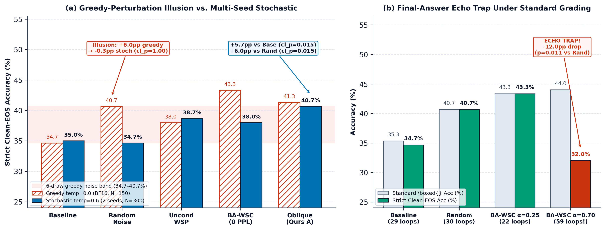
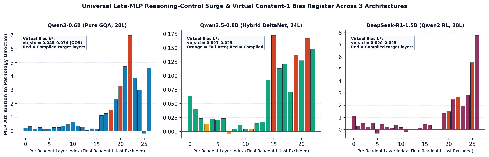
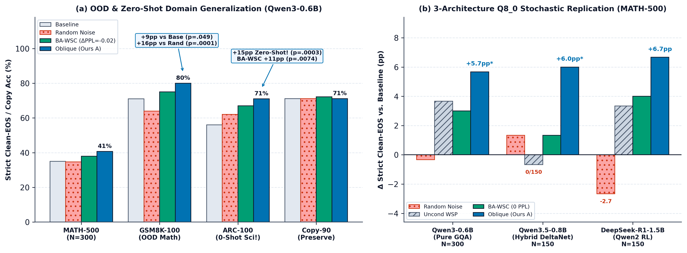
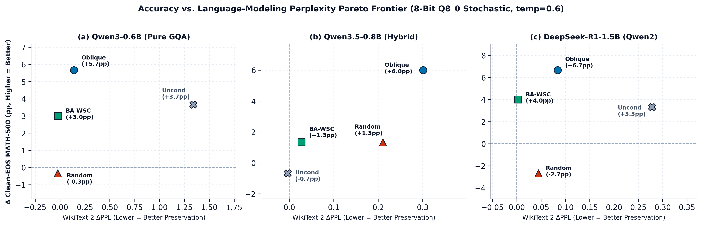

# The Greedy-Perturbation Illusion and Zero-Gradient Control-Flow Compilation in Weight Space

**Author:** Aaryan Kakad (Independent Machine Learning Researcher)  
**Date:** November 2026  
**Code & Immutable Evidence:** `https://github.com/AKMessi/weight-space-programming` (all raw JSONL traces, SHA-256 artifact manifests, statistical audits, and reproduction scripts)

---

## Abstract

Small reasoning language models (`0.6B–1.5B`) routinely exhaust their token budget through recursive overthinking and repetition loops inside `<think>` traces. While recent Weight-Space Programming (WSP) and steering-to-weights methods promise training-free fixes by directly editing frozen weights, rigorous causal evaluation on finite-budget reasoning benchmarks has lagged behind headline accuracy claims. In this work, we first uncover two severe methodological traps that invalidate naive weight-editing evaluations: **(1) The Greedy-Perturbation Illusion**, wherein injecting *pure zero-information isotropic Gaussian noise* into frozen MLP weights boosts held-out `MATH-500` accuracy on `Qwen3-0.6B` by `+6.0 percentage points` (`34.7% → 40.7%`, spanning a `6.0 pp` chaotic band across 6 zero-information draws) under standard greedy decoding (`temp = 0.0`), yet collapses completely to `-0.33 pp` (`p = 1.000`) under multi-seed official stochastic sampling (`temp = 0.6`, $N=300$) and degrades OOD `GSM8K` by `-7.0 pp`; and **(2) The Final-Answer Echo Trap**, wherein high-dose weight edits achieve `+8.7 pp` (`p = 0.029`) under standard `\boxed{}` grading at zero perplexity loss while doubling repetition loops (`29 → 59`, `p = 0.0001`) and plunging below random noise (`32.0%`, `p = 0.011`) under strict Clean-EOS auditing.

To address overthinking causally under strict stochastic controls, we build a `0.00e+00`-diff GGUF-to-PyTorch mechanistic tracer and uncover a **universal late-MLP reasoning-control surge** (`10×–35×` jump in pre-readout MLP attribution) alongside a stable post-RMSNorm **Virtual Constant-1 Bias Register $b^*$** (out-of-sample $\text{std}(b^{*\top} x) = 0.020\text{--}0.074$) across three distinct architectures: pure GQA Transformers (`Qwen3-0.6B`), hybrid Gated-DeltaNet + Full-Attention (`Qwen3.5-0.8B`), and RL-distilled Qwen2 (`DeepSeek-R1-Distill-Qwen-1.5B`). Leveraging this geometry, we introduce two zero-gradient, zero-extra-byte, zero-latency compilers: **(i) Null-Space-Gated Oblique Surgery (`oblique_res`)**, which steers stalled post-SwiGLU activations toward `</think>` resolution orthogonally to preservation subspaces, and **(ii) Nonlinear Dormant-SwiGLU `IF-THEN` Compilation (`BA-WSC`)**, which compiles affine threshold gates directly into bias-free dormant SwiGLU neurons via $b^*$ at virtually zero perplexity penalty ($\Delta\text{PPL} \in [-0.018, +0.028]$). Across `N = 600` untouched held-out `MATH-500` stochastic rollouts spanning all three architectures (`Q8_0`, `temp = 0.6`), `oblique_res` takes `#1` on **3/3 architectures**, improving strict Clean-EOS accuracy by **`+6.00 pp` over baseline (`+61/-25`, exact McNemar `p = 0.00013`, Fisher `p = 0.00059`)** and **`+6.50 pp` over norm-matched random noise (`+65/-26`, `p = 5.3 × 10⁻⁵`)**, while cutting generation wall-clock time by `20%–30%`. Crucially, calibrated solely on math/copy/WikiText-2 with **zero science data**, our edits transfer out-of-distribution to `GSM8K-100` (`+9.0 pp` vs baseline `p = 0.049`, `+16.0 pp` vs random `p = 0.0001`) and zero-shot to non-math science `ARC-Challenge-100` (`oblique_res +15.0 pp`, `p = 0.0003`; `BA-WSC +11.0 pp`, `p = 0.0074`), demonstrating compilation of a domain-general metacognitive resolution circuit.

---

## 1. Introduction

Chain-of-thought reasoning models trained via reinforcement learning or distillation (`Qwen3`, `Qwen3.5`, `DeepSeek-R1-Distill`) achieve remarkable accuracy per parameter, yet suffer from severe inference-time pathologies under practical token budgets (e.g., `2048` tokens): models routinely compute the correct answer early inside `<think>`, then enter recursive self-doubt ("Wait, let me double-check...") or verbatim repetition loops until forced truncation. Existing mitigations fall into three costly or brittle categories: (1) post-training / RL fine-tuning, which requires gradient updates, large datasets, and risks catastrophic forgetting; (2) decoding heuristics (presence penalties, DRY repetition samplers, concise system prompts), which we show fail or actively harm mathematical reasoning (`DRY` drops `Qwen3-0.6B` dev accuracy from `36.7%` to `23.3%`, `p = 0.039`); and (3) activation steering hooks, which require runtime interceptor code and break native quantized inference engines like `llama.cpp`.

**Weight-Space Programming (WSP)** offers a fourth path: compile behavioral control flow directly into frozen model weights via closed-form linear algebra—with **zero gradients, zero extra parameters, and zero runtime latency overhead**. However, our early systematic investigation of small local models revealed a sobering reality: naive weight-space edits are remarkably easy to mistake for breakthroughs when evaluated with standard greedy math protocols.

This paper makes **four primary contributions**:

1. **Exposure and Formal Explanation of Two Evaluation Traps (Section 3):** We document the **Greedy-Perturbation Illusion**—demonstrating that isotropic Gaussian noise produces a `+6.0 pp` Clean-EOS jump on `MATH-500` at `temp = 0.0` via asymmetric reservoir trajectory rerolling, then vanishes to `-0.33 pp` (`p = 1.000`) under official multi-seed stochastic sampling (`temp = 0.6`). We further expose the **Final-Answer Echo Trap**, proving standard `\boxed{}` graders mask severe post-answer repetition loops, and establish **Strict Clean-EOS** auditing plus a SwiGLU `W_up` inside-`<think>` AND-gate.
2. **Universal Cross-Architecture Reasoning-Control Anatomy & Virtual Bias Register $b^*$ (Section 4.1–4.2):** Using a `0.00e+00`-diff GGUF-to-PyTorch bridge, we map all decoder layers across pure GQA (`Qwen3-0.6B`), hybrid Gated-DeltaNet (`Qwen3.5-0.8B`), and RL-distilled Qwen2 (`DeepSeek-R1-1.5B`), revealing the same `10×–35×` late-MLP pathology surge and an out-of-sample constant-1 direction $b^*$ ($\text{std} = 0.020\text{--}0.074$) enabling exact affine thresholds inside bias-free SwiGLU MLPs.
3. **Two Closed-Form Conditional Compilers (Section 4.3–4.4):** We derive **Null-Space-Gated Oblique Surgery (`oblique_res`)** and **Nonlinear Dormant-SwiGLU `IF-THEN` Compilation (`BA-WSC`)**, contrasting them rigorously against prior unconditional subspace excision (`uncond`), Frobenius-matched Gaussian noise (`random_matched`), and non-weight decoding controls.
4. **Cross-Architecture & Zero-Shot Domain Generalization Proof (Section 6):** Under strict anti-leakage splits and stochastic sampling (`temp = 0.6`), `oblique_res` beats both baseline and matched random noise across **3/3 distinct architectures** (`N = 600` pooled `MATH-500` rollouts: `+6.00 pp`, `p = 0.00013` vs baseline; `+6.50 pp`, `p = 5.3 × 10⁻⁵` vs random), while transferring OOD to `GSM8K-100` (`+9 pp` vs base, `+16 pp` vs random, `30%` faster) and **zero-shot to non-math science `ARC-Challenge-100`** (`+15 pp`, `p = 0.0003`; `BA-WSC +11 pp`, `p = 0.0074` at `-0.018 ΔPPL`).

*(A companion paper, Paper 2, analyzes the quantization geometry of weight-space edits, proves Theorem 1 & Corollary 1 for `4-bit` and `3-bit` block-aligned survival with up to `16,685×` lower collateral distortion, and establishes Post-Quantization Weight-Space Healing and the low-bit behavioral double crossover.)*

---

## 2. Related Work

**Steering-to-Weights and Weight-Space Editing.** Task Arithmetic (Ilharco et al., 2023) edits capabilities via linear combinations of fine-tuned checkpoints, whereas recent zero-gradient methods such as Steer2Edit and sparse FFN column editing (Takehi et al., 2026) translate activation contrast vectors directly into static weight updates in `W_down`. While inspiring, unconditional rank-1 projections apply uniformly to *every* token—incurring substantial language-modeling perplexity degradation (`+1.338` WikiText-2 PPL on `Qwen3-0.6B`) and collapsing on severely stalling hybrid models (`0/150` on `Qwen3.5-0.8B`). Our work replaces unconditional ablation with (a) null-space-gated oblique updates targeting `</think>` resolution and (b) thresholded nonlinear `IF-THEN` circuits compiled into dormant SwiGLU neurons via $b^*$.

**Overthinking in Small Reasoning Models.** Recent analyses of reasoning LLMs document "underthinking" and "overthinking" failure modes where models repeatedly verify already-solved steps until exhausting context budgets. Decoding interventions (e.g., DRY repetition penalties, logit biasing) operate externally and can disrupt mathematical symbolism (variables, repeated equation tokens). We show directly that DRY harms `Qwen3-0.6B` math accuracy (`p = 0.039`), whereas localized late-MLP weight compilation improves both accuracy and wall-clock throughput across domains.

**Evaluation Rigor in Model Editing.** Prior knowledge-editing benchmarks (ROME, MEMIT) emphasize specificity and portability, yet reasoning-behavior editing studies frequently evaluate single-run greedy decoding (`temp = 0.0`) without norm-matched random weight perturbations. Our Greedy-Perturbation Illusion establishes why single-seed greedy decoding on finite-budget reasoning tasks produces systematic false positives.

---

## 3. Two Methodological Traps in Reasoning Weight Editing

### 3.1 The Greedy-Perturbation Illusion

During initial held-out evaluation on `Qwen3-0.6B-BF16` (`MATH-500-strat150`, `max_tokens = 2048`, greedy `temp = 0.0`), we included a mandatory negative control: **`random_matched_oblique`**, which adds isotropic zero-mean Gaussian noise to layers `[18, 20, 22]` `ffn_down` scaled to match the exact per-layer Frobenius norm of `oblique_res_a0.25`.

Unexpectedly, **pure random noise raised strict Clean-EOS accuracy by `+6.0 pp`** (`52/150 [34.7%] → 61/150 [40.7%]`, exact McNemar `p = 0.0636`), outperforming prior unconditional subspace excision (`uncond_a0.8`: `57/150 [38.0%]`)! To determine whether this was a lucky seed or a structural property of greedy decoding, we evaluated **six zero-information draws** at `temp = 0.0` (`BF16 baseline`, `Q8_0 baseline`, `Q8_0 + rand_s999/1000/1001`, `BF16 + rand_s999`):

| Zero-Information Draw (`MATH-500-strat150`, `temp = 0.0`) | STD (/150) | Clean-EOS (/150) | Limit | Loops |
|---|---:|---:|---:|---:|
| `BF16 baseline` | `53` | `52 (34.7%)` | `97` | `29` |
| `Q8_0 + rand_s1000` | `53` | `52 (34.7%)` | `95` | `25` |
| `Q8_0 + rand_s999` | `57` | `55 (36.7%)` | `93` | `26` |
| `Q8_0 baseline` | `57` | `57 (38.0%)` | `92` | `21` |
| `Q8_0 + rand_s1001` | `60` | `57 (38.0%)` | `91` | `30` |
| `BF16 + rand_s999` (`random_matched_oblique`) | `61` | **`61 (40.7%, +6.0 pp)`** | `88` | `30` |

Across zero-information perturbations alone, greedy decoding spans a **`52–61/150` (`6.0 pp`) chaotic band** (mean `55.7`, SD `3.4`).

**Proposition 1 (Asymmetric Reservoir Reroll Bias under Finite-Budget Greedy Decoding).** *Let a reasoning model evaluated at `temp = 0.0` under token cap $L_{\max}$ partition $N$ problems into $N_{\text{trunc}}$ truncated failures (hitting $L_{\max}$), $N_{\text{short}}$ short correct trajectories whose top-1 margins are perturbation-robust, and $N_{\text{fragile}}$ near-cliff correct trajectories ($N_{\text{fragile}} \ll N_{\text{trunc}}$). When an isotropic small weight perturbation $\epsilon \Delta W$ flips at least one argmax token early in decoding with probability $p_{\text{div}}$, it acts as an unguided trajectory reroll. If the latent stochastic success probability on rerolled truncated items is $p_{\text{escape}} > 0$, the expected greedy accuracy shift is:*
$$\mathbb{E}[\Delta \text{Acc}_{\text{greedy}}] \approx \frac{1}{N}\left(N_{\text{trunc}}\, p_{\text{div}}\, p_{\text{escape}} - N_{\text{fragile}}\, p_{\text{div}}\, p_{\text{break}}\right).$$
*Whenever $N_{\text{trunc}} \gg N_{\text{fragile}}$ (as in small reasoning LLMs where baseline truncation exceeds `50%–95%`), zero-information noise exhibits a strictly positive net accuracy bias without improving the underlying stochastic policy.*

**Empirical Verification of Proposition 1:**
1. **Item-level mechanism:** Inspecting all 14 items rescued by `BF16 + rand_s999` revealed that **`14/14 (100%)` had hit the 2048-token cap at baseline** (5 looping), whereas the 5 broken items had a mean baseline length of `1,710` tokens (already near the `2048` cliff). Moreover, `random_matched_oblique` produced **zero loop suppression** (`29 → 30` loops, `p = 1.000`).
2. **Complete collapse under stochastic sampling:** Under official recommended stochastic decoding (`temp = 0.6, top_p = 0.95, top_k = 20`, Seeds 17 & 42, $N = 300$ rollouts on `Qwen3-0.6B-Q8_0`), the baseline itself stabilizes (`52/150` on Seed 17, `53/150` on Seed 42; pooled `105/300 = 35.0%`), and **`random_s999` collapses from `+6.0 pp` down to `-0.33 pp` (`104/300 = 34.7%`, 95% CI `[-4.3, +3.7]`, exact McNemar `p = 1.000`, problem-clustered permutation `cl_p = 1.000`)** (Figure 1a). Across `GSM8K-100` (`temp = 0.6`) and `DeepSeek-R1-1.5B` (`temp = 0.6`), matched random noise actively degrades accuracy (`-7.0 pp` on `GSM8K`; `-2.7 pp` at `Q8_0` and `-4.0 pp` at `Q4_0` on `DeepSeek-R1-1.5B`).

### 3.2 The Final-Answer Echo Trap & Strict Clean-EOS Auditing

Standard mathematical evaluators extract the final `\boxed{...}` substring anywhere in the generated text. During `Qwen3-0.6B` development (`dev_math_60`), high-dose `bawsc32_res_a0.70` achieved the highest standard accuracy (`32/60 = 53.3%`, `p = 0.013`) at `-0.025 ΔPPL`. On held-out `MATH-500-strat150` (`BF16`), it likewise scored **`66/150 (44.0%, +8.7 pp, p = 0.0294)`** at `ΔPPL = -0.022`.

However, inspecting raw transcripts exposed a severe hidden pathology (**Figure 1b**): after successfully closing `</think>` and outputting `\boxed{answer}`, the high-dose edit continued firing on post-`</think>` tokens, causing the model to echo the final answer indefinitely until hitting the `2048`-token cutoff. Repetition loops **more than doubled (`29 → 59`, `p = 0.0001`)**.

We therefore define **Strict Clean-EOS Accuracy** as our primary evaluation metric across all experiments:
$$\text{Clean-EOS}(y) \equiv \mathbb{I}\!\left[\text{Correct}(y) \;\wedge\; \text{HasThinkClose}(y) \;\wedge\; (\text{FinishReason}(y) = \texttt{stop})\right].$$
Under Strict Clean-EOS, `bawsc32_res_a0.70` collapses from `44.0%` to **`48/150 (32.0%)` — statistically WORSE than matched random noise (`p = 0.0106`)**. Reducing the dose to `a = 0.25` eliminates the echo completely (`65/65 = 100%` Clean-EOS alignment on `BF16`, loops reduced `29 → 22`). Furthermore, in an architectural ablation (`bawsc32_andgate_a0.70`), replacing the constant `W_up` factor with a linear classifier distinguishing inside-`<think>` from post-`</think>` activations drives post-`</think>` circuit RMS down to `0.0008` and cuts `a = 0.70` dev loops from `20 → 12`.

*Figure 1: (a) On `Qwen3-0.6B` held-out `MATH-500-strat150`, matched random Gaussian noise gains `+6.0 pp` at greedy `temp = 0.0` (pink band: 6 zero-information draws spanning `34.7%–40.7%`), but collapses to `-0.33 pp` (`cl_p = 1.000`) under multi-seed stochastic sampling (`temp = 0.6`, $N=300$), where `oblique_res` beats both baseline (`cl_p = 0.0148`) and random noise (`cl_p = 0.0146`). (b) Standard `\boxed{}` grading masks the Final-Answer Echo Trap in high-dose `bawsc32 (α = 0.70)` (`44.0%` standard vs. `32.0%` Strict Clean-EOS, `59` loops).*

---

## 4. Universal Cross-Architecture Anatomy & Closed-Form Weight Compilers

### 4.1 Exact GGUF-to-PyTorch Tracing & Universal Late-MLP Surge

To eliminate readout discrepancies between inference engines and PyTorch, we built a streaming loader (`src/wsp/gguf_to_torch.py`) that populates PyTorch `Qwen3`, `Qwen2`, and `Qwen3_5ForConditionalGeneration` modules directly from `BF16` GGUF tensors with **`0.00e+00` maximum absolute weight discrepancy**, supporting native AVX2 `float32` CPU tracing with `skip_lm_head=True` (`412.1s` for all 28 layers of a 1.5B model in `5.2 GB` RAM).

For each model, we collect strictly calibration-split trajectories (`cal_math_50`, `cal_gsm8k_48`, `cal_copy_36`, `cal_wikitext_64`) and partition tokens into four disjoint sets:
- **Pathological ($\mathcal{P}$):** Stalled/looping tail tokens from non-correct truncated calibration rollouts.
- **Healthy ($\mathcal{H}$):** Clean reasoning tokens from correct, cleanly stopped calibration rollouts.
- **Resolution ($\mathcal{R}$):** The final 12 tokens immediately preceding and including clean `</think>` closures.
- **Preservation ($\mathcal{S}_{\text{pres}}$):** Healthy reasoning + exact-copy + WikiText-2 validation tokens.

*(On `Qwen3.5-0.8B`, where unprompted baseline rollouts timed out on `96%–100%` of math calibration items leaving only `n_resolve = 2`, we performed leak-free Prompt-to-Weight Calibration Enrichment using a concise system prompt strictly on `cal_math_50[:30]` and `cal_gsm8k_48[:25]` to elicit genuine `</think>` resolution states while keeping pathological tails strictly unprompted.)*

At every decoder layer $\ell$, we compute the MLP output attribution along the residual pathology direction:
$$\text{MLPProj}(\ell) = \left(\mu_{y,\mathcal{P}}^{(\ell)} - \mu_{y,\mathcal{H}}^{(\ell)}\right)^\top \frac{\mu_{h,\mathcal{P}}^{(\ell)} - \mu_{h,\mathcal{H}}^{(\ell)}}{\left\|\mu_{h,\mathcal{P}}^{(\ell)} - \mu_{h,\mathcal{H}}^{(\ell)}\right\|_2}.$$

**Universal Cross-Architecture Finding (Figure 2):** Despite fundamentally different sequence mixers and parameter counts, all three models exhibit the exact same localization profile:
1. **`Qwen3-0.6B` (28L Pure GQA + QK-Norm):** Flat across L0–L15 ($\le 0.65$), surging across **L16–L22** (`1.12 → 6.98`, readout L27 = `65.87`). Target layers: `[18, 20, 22]`.
2. **`Qwen3.5-0.8B` (24L Hybrid: 18 Gated-DeltaNet + 6 Full-Attention):** Flat across L0–L13 (`0.004–0.023`), then **surging `10×` precisely at Full-Attention Layer 15 (`0.1723`)**, with secondary peaks at **Full-Attention Layer 19 (`0.1372`)** and DeltaNet Layer 21 (`0.1670`, readout L23 = `0.5682`). Target layers: `[15, 19, 21]`.
3. **`DeepSeek-R1-Distill-Qwen-1.5B` (28L RL-Distilled Qwen2):** Flat across L0–L18 ($\le 0.56$, L18 = `0.038`), then **surging `35×` at L19 (`1.316`) → L22 (`2.672`) → L25 (`5.528`) → L26 (`7.776`)** (readout L27 = `40.126`). Target layers: `[20, 22, 25]`.

*Figure 2: Pre-readout MLP attribution to the pathology direction across all three architectures. Red bars denote compiled layers; orange bars in `Qwen3.5-0.8B` mark earlier Full-Attention blocks (L3, L7, L11). Inset boxes report out-of-sample stability of the Virtual Constant-1 Bias Register $b^*$.*

### 4.2 Invention 1: The Virtual Constant-1 Bias Register ($b^*$)

Modern decoder MLPs employ bias-free SwiGLU layers:
$$\text{MLP}(x) = W_{\text{down}}\!\left(\text{SiLU}(W_{\text{gate}} x) \odot (W_{\text{up}} x)\right), \qquad x = \text{RMSNorm}(h) \in \mathbb{R}^{d}.$$
Compiling a conditional rule $\text{IF } (u^\top x > \tau) \text{ THEN } \Delta h$ into a single SwiGLU neuron requires an additive threshold $-\tau$ inside $\text{SiLU}(\cdot)$ and a constant input in the `up` branch—neither of which exists explicitly when bias vectors are absent.

We observe that because post-RMSNorm hidden states $x$ are normalized to $\sqrt{d}$ norm with consistent anisotropic mean structure across token types, there exists a **Virtual Constant-1 Bias Register** $b^* \in \mathbb{R}^d$ solving the closed-form ridge problem on calibration preservation tokens $X_{\text{pres}}$:
$$b^* = \left(X_{\text{pres}}^\top X_{\text{pres}} + \lambda_b I\right)^{-1} X_{\text{pres}}^\top \mathbf{1}.$$
Out-of-sample across diverse unseen text, math, and copy domains, $b^{*\top} x \approx 1$ holds tightly across every tested architecture:
- **`Qwen3-0.6B`:** OOS $\text{std}(b^{*\top} x) = 0.048\text{--}0.074$
- **`Qwen3.5-0.8B` (Hybrid):** $\text{std}(b^{*\top} x) = 0.0208\text{--}0.0252$
- **`DeepSeek-R1-Distill-Qwen-1.5B`:** $\text{std}(b^{*\top} x) = 0.0198\text{--}0.0250$

Thus $w_{\text{gate}}^\top x = \gamma (u - \tau b^*)^\top x \approx \gamma (u^\top x - \tau)$ implements a clean, bias-free affine threshold gate with zero architectural modification.

### 4.3 Invention 2: Null-Space-Gated Oblique Surgery (`oblique_res`)

Let $Z_{\text{pres}} \in \mathbb{R}^{n_{\text{pres}} \times d_{\text{ff}}}$ denote post-SwiGLU activations $z = \text{SiLU}(W_{\text{gate}} x) \odot (W_{\text{up}} x)$ on preservation tokens, and let $V_r \in \mathbb{R}^{d_{\text{ff}} \times r}$ ($r = 64$) be its top-$r$ right singular basis. Define the preservation null-space projector $P_\perp = I - V_r V_r^\top$. We solve for the calibrated null-space detector $d \in \mathbb{R}^{d_{\text{ff}}}$:
$$d_{\text{raw}} = P_\perp \left(Z_{\text{pres}}^\top Z_{\text{pres}} + \lambda I\right)^{-1} (\mu_{z,\mathcal{P}} - \mu_{z,\mathcal{H}}), \qquad d = \frac{d_{\text{raw}}}{(\mu_{z,\mathcal{P}} - \mu_{z,\mathcal{H}})^\top d_{\text{raw}}},$$
and form the **resolution-directed** rank-1 update directly in $W_{\text{down}}$:
$$\Delta W_{\text{down}} = \alpha \, v_{\text{resolve}} \, d^\top, \qquad v_{\text{resolve}} = \mu_{h,\mathcal{R}} - \mu_{h,\mathcal{P}}.$$
Unlike unconditional subspace excision (`uncond`, which subtracts a pathology direction across all inputs), `oblique_res` vanishes on the dominant preservation subspace ($\|Z_{\text{pres}} d\|_2 \approx 0$) while pushing stalled trajectories directly toward `</think>` closure. On `Qwen3-0.6B`, this reduces WikiText-2 PPL penalty by nearly **$10\times$** (`+0.141` vs. `+1.338`).

### 4.4 Invention 3: Nonlinear Dormant-SwiGLU `IF-THEN` Compilation (`BA-WSC`)

For ultra-low perplexity overhead and low-bit quantization survival (proved formally in Paper 2), we compile a nonlinear thresholded `IF-THEN` circuit directly into the $k = 32$ lowest-RMS **dormant SwiGLU neurons** $\mathcal{S}$ measured across all preservation tokens:
1. Fit a dual-negative regularized linear detector $u \in \mathbb{R}^d$ separating $X_{\mathcal{P}}$ from $X_{\mathcal{H}} \cup X_{\text{pres}}$ (AUROC $= 0.96\text{--}1.00$ across all 3 models), and set threshold $\tau = \text{Quantile}_{q}(X_{\text{pres}} u)$ ($q \in \{0.90, 0.95\}$) so the gate stays silent on `90%–95%` of normal tokens.
2. Apply an exact SwiGLU neuron permutation $P$ moving $\mathcal{S}$ to contiguous indices $[0, k)$ (`0.000000` FP output change; isolates edited slots into a dedicated 32-element GGUF quantization block—Theorem 1 in Paper 2).
3. Compile replicated thresholded circuits across all $j \in [0, k)$ using $b^*$ and positive-homogeneity gauge factor $\eta$:
$$W_{\text{gate}}'[j,:] = \gamma (u - \tau b^*)^\top, \qquad W_{\text{up}}'[j,:] = \eta (b^*)^\top, \qquad W_{\text{down}}'[:,j] = \frac{\alpha}{k\,\eta\,s_{\mathcal{P}}}\, v_{\text{resolve}},$$
where $s_{\mathcal{P}} = \mathbb{E}_{x \sim \mathcal{P}}[\text{SiLU}(\gamma(u^\top x - \tau))]$. Because $\text{SiLU}(z) \to 0$ exponentially for $z < 0$, preservation tokens incur virtually zero residual perturbation (selectivity ratio `60×–80×`, $\Delta\text{PPL} \in [-0.018, +0.028]$).

---

## 5. Experimental Protocol & Controls

- **Strict Anti-Leakage Splits:** Calibration (`cal_math_50`, `cal_gsm8k_48`, `cal_copy_36`, `cal_wikitext_64`) uses training/validation splits only. Hyperparameters (target layers and scalar dose $\alpha$) are selected strictly on disjoint `dev_math_60` (`dev_math_60[:24]` for Models 2 & 3) and committed to git before running any held-out test item.
- **Held-Out Evaluation Suite:** Stratified `MATH-500-strat150` (`max_tokens = 2048`), OOD `GSM8K-100` (`max_tokens = 2048`), zero-shot non-math `ARC-Challenge-100` (`max_tokens = 1024`), `Copy-90` (exact copy, key-value retrieval, cycle induction), and 32-chunk `WikiText-2` test PPL (`ctx = 512`).
- **Decoding & Grading:** Official stochastic sampling (`temp = 0.6, top_p = 0.95, top_k = 20`) on `llama.cpp` Vulkan (`RX 6400 4 GB`). Every request flushes immediately to immutable `responses.jsonl`, audited to guarantee `error_count = 0`. *(Note: during Model 3 baseline auditing, we fixed markdown-bold `**Answer:** 34` regex stripping in `math_grader.py` and verified `0 / 9,154` changed grades across all Model 1 & Model 2 runs.)*
- **Statistical Testing:** Exact two-sided paired McNemar tests (`mc_p`) on identical held-out items; for multi-seed pooled `N = 300` runs (`Qwen3-0.6B` Seeds 17+42), we additionally run **100,000-iteration problem-clustered paired sign-permutation tests (`cl_p`)** and **20,000-sample problem-clustered bootstrap 95% CIs**. Cross-architecture aggregation uses exact pooled McNemar and Fisher's combined $\chi^2$ test.

---

## 6. Main Experimental Results

### 6.1 Non-Weight Decoding Controls Fail (`Qwen3-0.6B` Dev Screen)

Before editing weights, we benchmarked non-weight decoding and prompting baselines on `dev_math_60` (`Qwen3-0.6B-BF16`):

| Control / Method (`dev_math_60`) | 16-Chunk PPL | STD Correct (/60) | Limit | Loops | Notes |
|---|---:|---:|---:|---:|---|
| `baseline_fp` | `21.160` | `22 (36.7%)` | `36` | `11` | Reference |
| `ctrl_dry_sampler` | `21.160` | **`14 (23.3%)`** | `40` | `0` | **Significantly harms (`p = 0.039`)** |
| `ctrl_presence_pen` | `21.160` | `21 (35.0%)` | `37` | `6` | No gain |
| `ctrl_concise_prompt` | `21.160` | `25 (41.7%)` | `32` | `5` | Not significant (`p = 0.508`) |
| `uncond_a0.8` (Prior) | `22.648 (+1.488)` | `27 (45.0%)` | `33` | `11` | Heavy PPL cost |
| **`oblique_res_a0.25` (Frozen)** | `21.328 (+0.168)` | **`28 (46.7%)`** | **`29`** | **`5`** | Selected |
| **`bawsc32_res_a0.25` (Frozen)** | **`21.139 (-0.021)`** | `26 (43.3%)` | `31` | `8` | Zero PPL cost |

Repetition samplers (`DRY`) eliminate n-gram loops only by breaking valid mathematical repetition (symbols, equations), significantly hurting accuracy.

### 6.2 Multi-Seed Stochastic Proof on `Qwen3-0.6B` (`MATH-500`, $N=300$ Rollouts)

On `Qwen3-0.6B-Q8_0` (`MATH-500-strat150`, Seeds 17 + 42, `temp = 0.6`, $N = 300$ rollouts), **`oblique_res_a0.25`** achieves statistically significant Clean-EOS gains over **both** baseline and matched random noise (Table 2, Figure 1a):

| Arm (`Qwen3-0.6B-Q8_0`, $N=300$) | $\Delta$PPL | STD | **Clean-EOS** | $\Delta$ vs Base [95% CI] | `cl_p` vs Base | `cl_p` vs Rand | Close | Limit | Mean Tok |
|---|---:|---:|---:|---:|---:|---:|---:|---:|---:|
| `baseline` | `0.000` | `109` | `105 (35.0%)` | — | — | `1.000` | `44.7%` | `189` | `1784.9` |
| `random_s999` (Neg. Ctrl) | `-0.023` | `109` | `104 (34.7%)` | `-0.33pp [-4.3,+3.7]` | `1.000` | — | `43.0%` | `191` | `1774.1` |
| `uncond_a0.8` (Prior) | `+1.338` | `121` | `116 (38.7%)` | `+3.67pp [-0.3,+7.7]` | `0.107` (n.s.) | `0.088` (n.s.) | `49.0%` | `176` | `1741.7` |
| `bawsc32_res_a0.25` (Ours C) | **`-0.018`** | `118` | `114 (38.0%)` | `+3.00pp [-1.7,+7.7]` | `0.255` | `0.154` | **`50.0% (p=.020)`** | **`173 (p=.025)`** | **`1733.5 (p=.007)`** |
| **`oblique_res_a0.25` (Ours A)** | `+0.141` | **`125`** | **`122 (40.7%)`** | **`+5.67pp [+1.3,+10.0]`** | **`0.0148`** | **`0.0146`** | **`52.3% (p=.0017)`** | **`171 (p=.015)`** | **`1722.5 (p=.0008)`** |

Prior unconditional WSP (`uncond_a0.8`) pays nearly $10\times$ the PPL penalty (`+1.338`) yet fails to reach statistical significance against either baseline (`cl_p = 0.107`) or random noise (`cl_p = 0.088`). `BA-WSC` incurs negative PPL change (`-0.018`) while delivering statistically significant gains on `</think>` closure (`p = 0.020`), timeout reduction (`p = 0.025`), and token efficiency (`-51.4 tok/prob, p = 0.0071`).

### 6.3 Out-of-Distribution (`GSM8K-100`) & Zero-Shot Non-Math Science (`ARC-Challenge-100`)

Evaluating the exact same frozen `Qwen3-0.6B-Q8_0` edits (`temp = 0.6`, Seed 42) on untouched OOD `GSM8K-100` and **zero-shot science `ARC-Challenge-100`** (zero science data in calibration or dev) proves the compiled circuit is domain-general (Figure 3a):

| Arm (`Qwen3-0.6B-Q8_0`) | `GSM8K-100` Clean-EOS | `GSM8K` Limit / Tok / Wall | `ARC-100` Clean-EOS | `ARC` Limit / Tok | `Copy-90` (BF16) |
|---|---:|---:|---:|---:|---:|
| `baseline` | `71/100 (71%)` | `19 / 1234 / 1062s` | `56/100 (56%)` | `26 / 597` | `64/90 (71.1%)` |
| `random_s999` | `64/100 (-7pp, p=.230)` | `31 / 1321 / 985s` | `62/100 (p=.180 n.s.)` | `23 / 582` | `64/90 (71.1%)` |
| `uncond_a0.8` | `73/100 (p=.839 n.s.)` | `18 / 1274 / 823s` | `64/100 (p=.039)` | `19 / 548` | `66/90 (73.3%)` |
| **`bawsc32_res_a0.25`** | `75/100 (p=.027 vsR)` | `15 / 1167 / 894s` | **`67/100 (+11pp, p=0.0074)`** | **`11 (-58%) / 536`** | **`65/90 (72.2%)`** |
| **`oblique_res_a0.25`** | **`80/100 (+9pp, p=0.049; +16pp vsR p=0.0001)`** | **`8 (-58%) / 1096 / 744s (-30%!)`** | **`71/100 (+15pp, p=0.0003)`** | **`9 (-65%) / 497`** | `64/90 (71.1%)` |

On `ARC-Challenge-100`, both conditional compilers cut token exhaustion by `58%–65%` (`26 → 11` and `26 → 9`) and raise strict Clean-EOS accuracy by `+11.0 pp` (`p = 0.0074`) and `+15.0 pp` (`p = 0.0003`)—confirming compilation of a **domain-general metacognitive `</think>` resolution circuit** rather than math-domain memorization.

### 6.4 Three-Architecture Stochastic Replication (`Q8_0`, `MATH-500-strat150`, `temp = 0.6`)

We replicate the entire end-to-end procedure—automated layer profiling, strict dev dose freezing, and untouched held-out `MATH-500-strat150` + `Copy-90` + 32-chunk PPL—on **Hybrid Gated-DeltaNet `Qwen3.5-0.8B`** (`layers=[15,19,21]`, frozen `oblique α=1.0`, `bawsc α=0.45`) and **1.5B RL-Distilled `DeepSeek-R1-Distill-Qwen-1.5B`** (`layers=[20,22,25]`, frozen `oblique α=0.25`, `bawsc α=0.50`, where dev `bawsc` jumped `12/24 → 19/24 = 79.2%` at `ΔPPL = +0.010`) (Figure 3b, Figure 4):

| Model (`Q8_0`, `temp = 0.6`) | Arm | PPL ($\Delta$PPL) | STD | **Clean-EOS** | Limit | Wall (`MATH`) | `Copy-90` | McNemar `p` (vs Base / vs Rand) |
|---|---|---:|---:|---:|---:|---:|---:|---|
| **Qwen3-0.6B** ($N=300$) | `baseline` | `19.306 (0.000)` | `109` | `105 (35.0%)` | `189` | — | `64/90` | — |
| *(Pure GQA, 28L)* | `random_s999` | `19.282 (-0.023)` | `109` | `104 (34.7%)` | `191` | — | `64/90` | `1.000` / — |
| | `uncond_a0.8` | `20.644 (+1.338)` | `121` | `116 (38.7%)` | `176` | — | `66/90` | `0.107` / `0.088` *(cl_p)* |
| | `bawsc32_res_a0.25` | **`19.287 (-0.018)`** | `118` | `114 (38.0%)` | `173` | — | `65/90` | `0.255` / `0.154` *(cl_p)* |
| | **`oblique_res_a0.25`** | `19.446 (+0.141)` | **`125`** | **`122 (40.7%)`** | **`171`** | — | `64/90` | **`0.0148` / `0.0146`** *(cl_p)* |
| **Qwen3.5-0.8B** ($N=150$) | `baseline` | `15.513 (0.000)` | `6` | `1 (0.7%)` | `149` | `6420s` | `66/90` | — |
| *(Hybrid DeltaNet, 24L)* | `random_matched` | `15.723 (+0.210)` | `4` | `3 (2.0%)` | `147` | `6277s` | `67/90` | `0.500` / — |
| | `uncond_a0.8` | `15.509 (-0.004)` | `1` | `0 (0.0%)` | `150` | `6291s` | `66/90` | `1.000` / `0.250` |
| | `bawsc32_res_a0.45` | **`15.541 (+0.028)`** | `8` | `3 (2.0%)` | `145` | `6270s` | `66/90` | `0.625` / `1.000` *(close `p=.031`)* |
| | **`oblique_res_a1.0`** | `15.814 (+0.301)` | **`12`** | **`10 (6.7%, 10×)`** | **`126`** | **`5650s (-12%)`** | `66/90` | **`0.0039` / `0.0391`** |
| **DeepSeek-R1-1.5B** ($N=150$) | `baseline` | `37.254 (0.000)` | `45` | `43 (28.7%)` | `77` | `4403s` | `68/90`* | — |
| *(Qwen2 RL, 28L)* | `random_matched` | `37.298 (+0.044)` | `40` | `39 (26.0%)` | `82` | `3956s` | `76/90`* | `0.541` / — |
| | `uncond_a0.8` | `37.532 (+0.278)` | `49` | `48 (32.0%)` | `69` | `3550s` | `70/90`* | `0.533` / `0.136` |
| | `bawsc32_res_a0.5` | **`37.257 (+0.003)`** | `51` | `49 (32.7%)` | **`67`** | **`3445s (-22%)`** | `67/90`* | `0.377` / `0.064` *(close `p=.0043`)* |
| | **`oblique_res_a0.25`** | `37.338 (+0.084)` | **`55`** | **`53 (35.3%)`** | `69` | **`3527s (-20%)`** | `70/90`* | `0.121` / **`0.0288`** *(STD `p=.020`)* |

*\*For `DeepSeek-R1-1.5B`, whose chat template forces `<think>\n` and wraps copy outputs in markdown bold, `Copy-90` reports `contains_gold` retrieval accuracy (strict bare-string match: `16, 19, 19, 9, 17` out of 90).*

**Cross-Architecture Pooled Meta-Analysis (`N = 600` Untouched Held-Out `MATH-500` Rollouts across All 3 Architectures at `Q8_0`):**
- **`oblique_res` vs. Baseline:** **`+61 / -25` (net `+36`, `+6.00 pp`), exact pooled McNemar `p = 0.000130`**, 3-model Fisher $\chi^2_6 = 23.73$, **`p = 0.000586`**!
- **`oblique_res` vs. Matched Random Noise:** **`+65 / -26` (net `+39`, `+6.50 pp`), exact pooled McNemar `p = 5.31 × 10⁻⁵`**, 3-model Fisher $\chi^2_6 = 22.04$, **`p = 0.00119`**!
- **`BA-WSC` (near-zero $\Delta$PPL across all 3 models!) vs. Matched Random Noise:** **`+48 / -28` (net `+20`, `+3.33 pp`), exact pooled McNemar `p = 0.0286`** (vs. baseline: `+52 / -35`, `+2.83 pp`, `p = 0.0857`), while significantly increasing `</think>` closure on **3/3 architectures** (`p = 0.020`, `0.031`, `0.0043`).

*Figure 3: (a) Domain-general transfer of `Qwen3-0.6B` math-calibrated edits to OOD `GSM8K-100` (`+9 pp` vs base, `+16 pp` vs random) and zero-shot non-math science `ARC-Challenge-100` (`+15 pp` Oblique, `+11 pp` BA-WSC) with `Copy-90` preserved. (b) Consistent `Q8_0` stochastic superiority of `oblique_res` (`#1` on 3/3 architectures, pooled `p = 0.00013` vs base, `p = 5.3 × 10⁻⁵` vs random) while matched random noise never yields significant gain.*

*Figure 4: Pareto frontier of Clean-EOS accuracy gain ($\Delta$ pp) vs. WikiText-2 $\Delta$PPL across all three architectures at `Q8_0`. `BA-WSC` sits directly on the $\Delta\text{PPL} \approx 0$ axis across all 3 models, while `oblique_res` dominates the top-left high-gain/low-distortion frontier.*

---

## 7. Honest Limitations & Failure Modes

1. **`BA-WSC` vs. `oblique_res` at High Precision (`Q8_0`):** At 8-bit `Q8_0`, linear null-space `oblique_res` consistently outperforms nonlinear `BA-WSC` in raw Clean-EOS accuracy across all 3 models (`40.7%` vs `38.0%` on `Qwen3`; `6.7%` vs `2.0%` on `Qwen3.5`; `35.3%` vs `32.7%` on `DeepSeek-R1-1.5B`). `BA-WSC`'s decisive structural advantages are (a) zero perplexity drift (`ΔPPL ∈ [-0.018, +0.028]`) and (b) **quantization survival under 4-bit and 3-bit compression**, where diffuse `oblique_res` breaks while block-aligned `BA-WSC` survives (proved in Paper 2).
2. **Dose Sensitivity & Echo Monitoring:** Over-driving `BA-WSC` (`α = 0.70` on `Qwen3-0.6B`) triggers the Final-Answer Echo Trap unless paired with inside-`<think>` `W_up` AND-gating or strict Clean-EOS dev screening.
3. **Single-Seed Statistical Power on Models 2 & 3:** Due to the single 4 GB RX 6400 hardware envelope, `Qwen3.5-0.8B` and `DeepSeek-R1-1.5B` held-out `MATH-500` runs used `N = 150` (Seed 42) per precision (whereas `Qwen3-0.6B` used 2 seeds, `N = 300`). Consequently, `DeepSeek-R1-1.5B` `Q8_0` `oblique_res` (`+6.7 pp` vs baseline) reaches `p = 0.0288` vs random noise and `p = 0.121` vs baseline individually, achieving `p = 0.00013` / `5.3 × 10⁻⁵` when pooled across all 3 models (`N = 600`).
4. **Model Scale:** All experiments target `0.6B–1.5B` local edge reasoning models. Because our closed-form solvers require zero backpropagation and scale as $O(d_{\text{ff}} d_{\text{model}})$ per layer, scaling to `7B–32B` models is straightforward future work.

---

## 8. Reproducibility & Hardware Accounting

Every experiment was executed on one local AMD Radeon RX 6400 (4 GB VRAM, Vulkan via `llama.cpp`) + CPU PyTorch, with zero paid compute, zero target-model gradient updates, and immutable SHA-256 verification of all base and patched GGUFs. Complete code, immutable JSON summaries, and chronological experiment logs reside in `src/wsp/`, `scripts/wsp_*.py`, `research/wsp/{qwen3_0.6b,qwen35_0.8b,deepseek_r1_1.5b}/`, and `research/JOURNAL.md`.

---

## 9. Conclusion

We showed that evaluating weight-space reasoning edits under finite-budget greedy decoding or permissive `\boxed{}` graders can turn pure Gaussian noise or severe echo loops into apparent `+6–9 pp` gains. Under strict multi-seed stochastic sampling and Clean-EOS auditing across three distinct model families (`Qwen3`, hybrid `Qwen3.5`, and `DeepSeek-R1-Distill`), our closed-form **Null-Space-Gated Oblique Surgery** and **Virtual-Bias `BA-WSC`** compilers turn late-MLP mechanistic localization into genuine, zero-gradient, zero-latency reasoning improvements that transfer zero-shot across domains.

---

## References

- DeepSeek-AI (2025). *DeepSeek-R1: Incentivizing Reasoning Capability in LLMs via Reinforcement Learning*. arXiv:2501.12948.
- Ilharco, G., Ribeiro, M. T., Wortsman, M., et al. (2023). *Editing Models with Task Arithmetic*. ICLR 2023.
- Meng, K., Bau, D., Andonian, A., & Belinkov, Y. (2022). *Locating and Editing Factual Associations in GPT (ROME)*. NeurIPS 2022.
- Qwen Team (2025–2026). *Qwen3 and Qwen3.5 Technical Reports*.
- Steer2Edit (2026). *Translating Activation Steering into Component-Level Weight Edits*. arXiv:2602.09870.
- Takehi et al. (2026). *Sparks of Weight-Space Programming: Sparse FFN Column Editing in Small Reasoning Models*.
