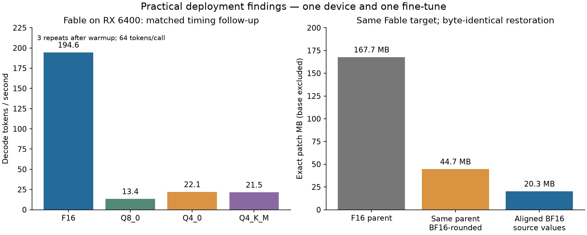
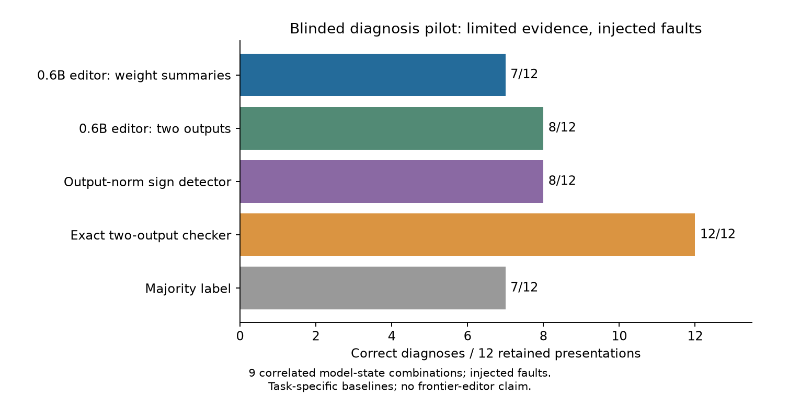

# Five-pilot portfolio results

five bounded pilots with negative prerequisite closures; not five paper-ready studies

Phase totals: 137 runs, 2761 inference requests, 107388 generated tokens. Raw evidence, schema corrections and rejected candidates are retained.

Run statuses: 136 complete, 1 failed attempts. The intended editor trial completed through a separately frozen full-batch retry.

Code tables use current versioned sensitivity grading: v6 separates a leading function from trailing prose and checks requested API signatures/fences; v7 adds measurement-only fixtures. Original v4/v5 records and frozen selections remain intact. Copying, JSON, evidence decisions and diagnosis semantics are unchanged. Conditional grouped uncertainty is in results.json; it is not population certainty.

- [Experiment 1](experiment-1.md)
- [Experiment 2](experiment-2.md)
- [Experiment 3](experiment-3.md)
- [Experiment 4](experiment-4.md)
- [Experiment 5](experiment-5.md)

Useful-repair and composition prerequisites must be read separately from completed stress measurements. Unsupported activation methods, a precision allocator, a large independently useful patch library, interactive frontier diagnosis, and paper-scale independent confirmation have not been performed. See machine-readable results for every source hash, actual run and decision.

## Practical results and integrity

Read the [plain-language findings](../FINDINGS.md), [exact checkpoint patch guide](../EXACT_PATCH_DELIVERY.md), [deployment/symmetry follow-up](supplement/README.md), [matched comparison audit](comparison-audit.md), and [reproduction guide](../../docs/REPRODUCING.md). The full project totals are 166 complete runs, one failed attempt, 3,999 actual calls and 149,296 generated tokens. The 34-test suite passes. The [final evidence audit](../evidence-integrity-final-v2.json) reconciles every reservation; a separate [full-file snapshot](../evidence-integrity-final-v1.json) checked 65 current model binaries.

The exact Fable patch excludes the required matching base. Timing results are from three repeated short-context calls on one device, after warmup. No quality score or kernel-cause claim is attached to that microbenchmark.

The local editor's weights-only diagnosis ties the majority baseline and mislabels all healthy presentations. This small injected-fault pilot does not test a frontier model with full interactive weight access.
